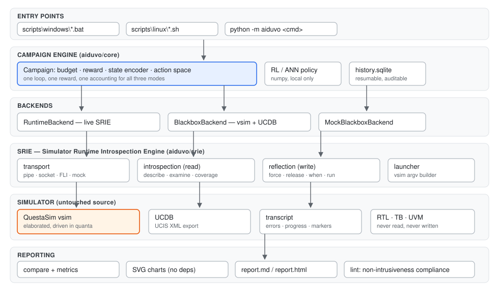
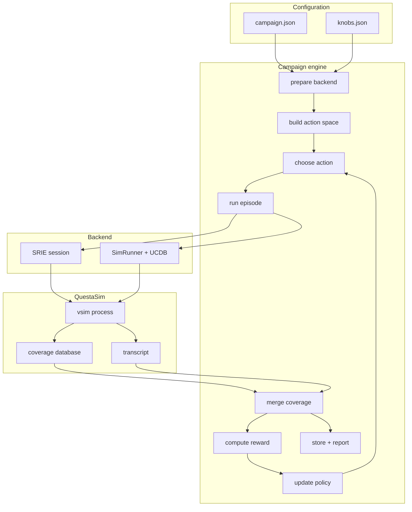
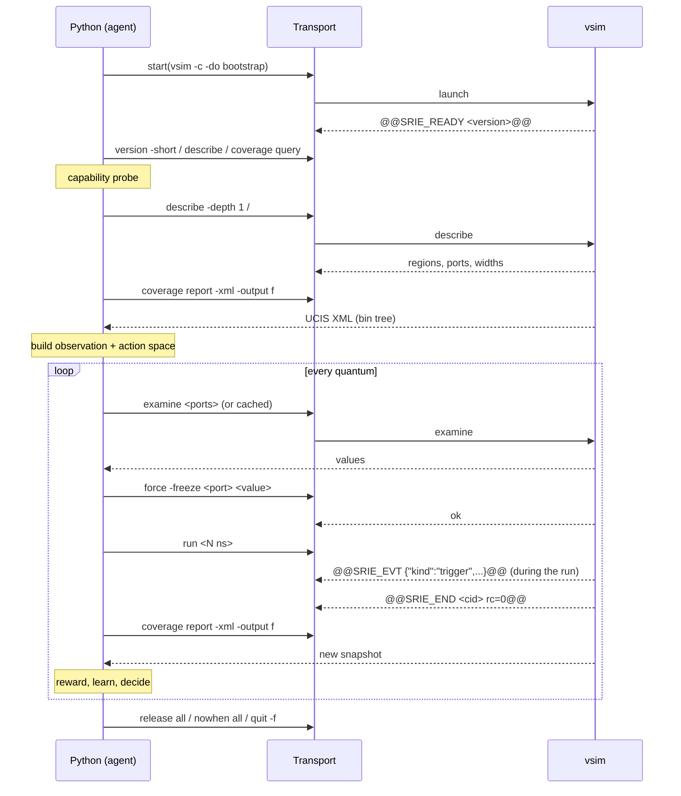

# Architecture



## Layers

```
┌──────────────────────────────────────────────────────────────────────────────┐
│  entry points                                                                │
│    scripts/windows/*.bat     scripts/linux/*.sh     python -m aiduvo ...      │
├──────────────────────────────────────────────────────────────────────────────┤
│  orchestration            aiduvo/core/engine.py   (Campaign)                 │
│    budget · reward · state encoder · action space · policy · history store    │
├──────────────────────────────────────────────────────────────────────────────┤
│  backends                 aiduvo/srie/optimizer.py     (live, SRIE)          │
│                           aiduvo/blackbox/backend.py   (closed box)          │
│                           aiduvo/blackbox/backend.py   (mock, synthetic)     │
├──────────────────────────────────────────────────────────────────────────────┤
│  simulator access         aiduvo/srie/                                       │
│    transport   pipe · Tcl socket · FLI · mock                                │
│    tcl         command builders + tolerant parsers                           │
│    introspection  describe / examine / coverage      (read)                  │
│    reflection     force / release / when / run        (write, guarded)       │
├──────────────────────────────────────────────────────────────────────────────┤
│  shared services                                                            │
│    coverage/  model · UCIS/CSV/text importers · metrics · SQLite store        │
│    rl/        bandits · tabular Q · DQN · PPO · ANN surrogate · numpy MLP     │
│    reporting/ comparison · SVG charts · markdown · HTML                      │
│    discovery/ hierarchical discovery -> generated config                     │
│    semantics/ optional role annotation                                       │
│    lint/      non-intrusiveness compliance checker                           │
└──────────────────────────────────────────────────────────────────────────────┘
```

## Data flow of one campaign



## The runtime loop in detail



## Cooperative quanta

A simulator's command interpreter is single-threaded: while `run 1000 ns` is
executing, it is not reading commands. AId-UVO-RT therefore drives the simulator
in **quanta** — `run <quantum_cycles * period>` — and makes a decision between
quanta. This is the standard way to get deterministic, reproducible runtime
steering, and it has two useful properties:

* the agent can act at any cycle boundary, so "instantaneous" is bounded by one
  quantum, not by the end of the run;
* value-change triggers installed with `when` still fire *inside* a quantum and
  push events immediately, so the agent can also react to specific events by
  shortening the next quantum.

`quantum_cycles` is the main latency/overhead knob: 100–500 cycles is a good
starting point for a small block; a large SoC wants 1 000–10 000.

## Files produced by a campaign

```
runs/<mode>_<algo>_<timestamp>/
├── campaign_config.json      the exact config used (reproducible)
├── campaign_result.json      curve, episodes, metadata, final metrics
├── history.sqlite            per-run snapshots, per-bin hits, actions
├── policy.npz / policy.json  the learned model (AI modes)
├── _artifacts/run_0000/      transcript.log, coverage.ucdb, run.do  (blackbox)
└── _srie_work/               generated bootstrap, per-run vsim logs  (runtime)
```

## Why the reward and the state encoder live in `core`

Both backends must be measured the same way, so the reward function and the state
encoder are backend-agnostic and are applied by the campaign engine, not by the
backend. The backend's only job is to turn an `Action` into an `EpisodeResult`
plus a coverage snapshot.
